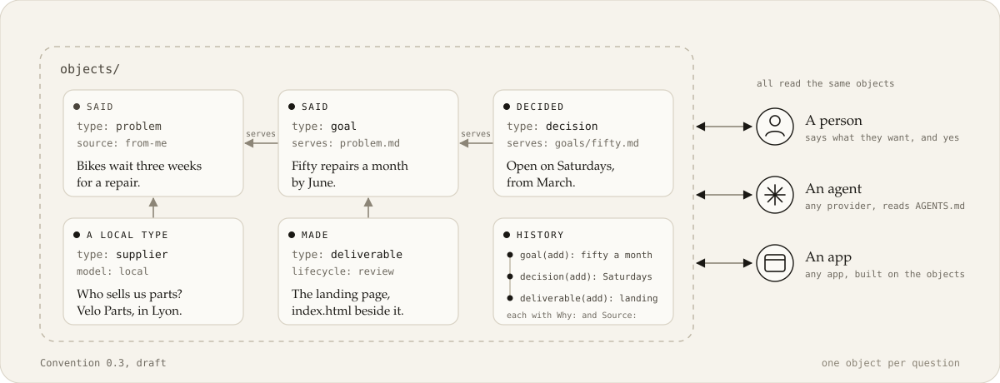
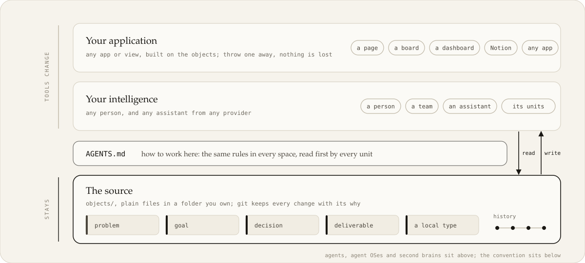
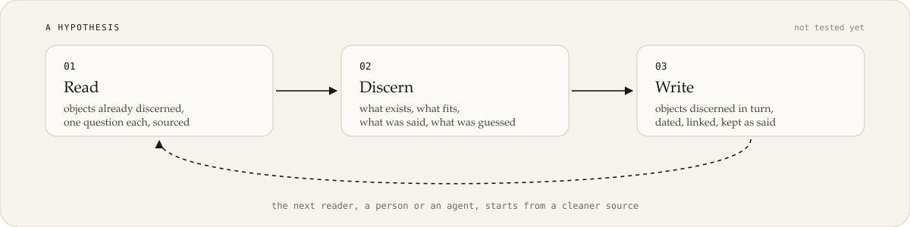
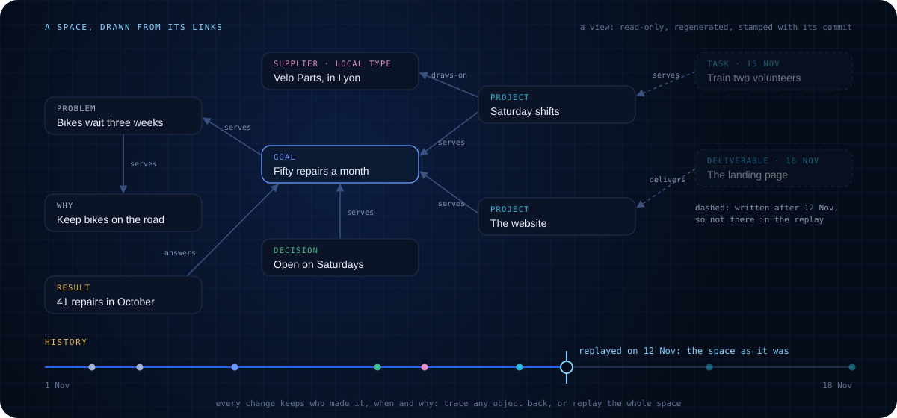

<p align="center"></p>

# Everything is an object.

**[Simple](#eight-words)** · **[Yours](#try-it)** · **[Readable](tests/runs/03-resume/)** · **[Kept](tests/runs/README.md#each-check)** · **[Open](#license)**

An object is anything made explicit that answers one question: what someone said, decided or
wants, and what was made for it, a plan, a page, code. A few header lines say which question it
answers, what it serves, who said or made it, and where it stands. What a person said keeps their
words. Everything else is a link, a view or a change.

```markdown
---
type: goal
model: goals@0.1
question: What do we want now, and how will we know?
serves: objects/problem.md
source: from-me
lifecycle: active
evidence: open
date: 2026-11-15
---

Repair fifty bikes a month by June. We will know when the logbook shows fifty for three months in a row.
```

What is made is an object too. A page, with its files, is a folder whose `README.md` carries the
header:

```
objects/deliverables/landing/
├─ README.md     the header, and what the page is for
└─ index.html    the page itself
```

```markdown
---
type: deliverable
model: work@0.1
question: What comes out, and is it done?
serves: objects/projects/website.md
source: inferred
lifecycle: review
evidence: open
date: 2026-11-18
---

The landing page, in `index.html` beside this file. Done when a visitor can say in one sentence what we do.
```

That is the idea. This repository is **the Convention**: one way to write it down, so that people
and agents read and act on the same things. As "everything is a file" is an idea and POSIX one way
to encode it, "everything is an object" is the idea, and the convention one encoding of it.

It is meant to look obvious. Files, a header, links and git are all old. What is new is that every
object says which question it answers, so every space has the same shape: you can read anyone's
space, and so can any agent and any app.

Convention 0.3, draft · setup prompt 3.1, draft

## Why objects

A file holds bytes and a path. A page holds text and a place in a tree. An object holds meaning:
which question it answers, what it serves, who said or made it, and where it stands. A person and
an intelligence can both read that, check it and act on it, so it becomes a common language between
them. An object can live in a file or in a Notion page: its header is what makes it an object.

The tools that lasted started from one simple object: the file in Unix, the cell in a spreadsheet,
the page and its link on the web, the commit in git. Any signal, a message, a voice note, a meeting,
an issue, becomes objects, linked to the ones already there. What people want, decide and make had
no such object that people and agents share.

## Bring your intelligence. Bring your application.

<p align="center"></p>

- **Your intelligence.** Any person, and any assistant from any provider that can read and write
  files. Each reads `AGENTS.md` first, then the objects, so none starts from zero. Only the
  features differ from one tool to another; the rules are the same.
- **Your application.** Any assistant can build the apps and views you want on the objects: a page,
  a board, a dashboard. They read the objects and write back to them, so any app can be thrown away
  and built again.
- **The source stays.** Plain files in a folder you own. git keeps every change with its reason,
  and is the default; Notion shows the same objects as pages, through an
  [adapter](convention/adapters.md).

Agents, agent operating systems and second brains each keep their own idea of what you want, in
their own format. The convention sits one layer below them, where all of them can read it.

## How it works

Every unit of a space reads one file first: `AGENTS.md`. A unit is a person, or an intelligence in
its own session, holding one role; what differs from one unit to another is the role its brief
gives it. Five of the ten sections are capabilities, the same word for word in every space. The
other five come from the space's own objects: why it exists, what it wants now, who may do what,
where things are, and its own rules ([the ten sections](convention/roles.md#agentsmd-the-file-every-unit-reads-first)).

| Section | What it makes happen |
|---|---|
| **3. Make it explicit** | what is said, decided or made becomes objects, in the person's words, linked to what they serve |
| **4. Answer and propose** | an answer at once; when something is yours to choose, one proposal, a recommendation and a default; nothing goes out before your yes |
| **5. Delegate** | the assistant gives each piece to a unit with its role; a checker that did not make it checks what a maker made; a role starts more of itself when the load grows |
| **6. Build on the objects** | any page, view or app reads the objects and writes back to them |
| **7. Keep every change** | one commit per change, with its why; a correction reverses only what was wrong |

Each capability is written in the eight words, so it can be drawn, followed and tested (proposed). Below,
sections 3 and 5, drawn from their own lines. A rule that cannot be drawn is rewritten until it can
([writing](convention/writing.md#a-rule-can-be-drawn-proposed)). The whole file, as every space
starts from it: [`setup/AGENTS.template.md`](setup/AGENTS.template.md).

<p align="center"></p>

<p align="center"></p>

## What it aims to solve

What anyone wants is lost each time it is passed on: from a person to a tool, from one session to
the next, from one agent to another ([the problem](https://github.com/thevzion/source/blob/main/objects/problem.md)).
Written once as objects, it is kept. Each line is an ambitious hypothesis, not a result: a trial
shows what a few agents did in a fictional space.

| Problem | The hypothesis | Tested so far by |
|---|---|---|
| **Continuity**: each new session, tool or person starts from zero | anyone resumes from the folder alone | [another session resumes from the source](tests/runs/03-resume/) |
| **Shared meaning**: each tool keeps its own idea of what you want | a type is a question, word for word, and a repeated want enriches the object already there | [a repeated signal enriches the existing object](tests/runs/02-reuse/) |
| **Authorship**: what you said and what was guessed look the same | every object says `source: from-me` or `source: inferred` | [the inferred is marked, quotes are exact](tests/runs/15-quotes/); but [placement](tests/runs/09-placement/), 1/5 in batch 3, still marks words the agent rephrased as the person's |
| **Delegation**: you repeat yourself and watch the agent work | work goes out with a brief that stands alone, comes back as objects, and nothing leaves before your yes | [what goes out waits for a yes](tests/runs/10-goes-out/) |
| **Verification**: you review everything, or nothing | every change keeps its reason, and a correction touches only what was wrong | [a correction keeps the history](tests/runs/29-correction/) |
| **The commons**: what one space learns stays there | a local type returns across spaces, becomes a seed, then a model others install | not tested yet |

Shared meaning and the commons cannot be solved by one space: they need many spaces, and the people
who use them.

## Why it may work

<p align="center"></p>

An agent works from what it reads. Here it reads objects already discerned, so it should discern
better, and spend less, than from a long conversation; what it writes is discerned in turn. None of
it is new: [what came before](convention/README.md#prior-art).

## What it makes possible

<p align="center"></p>

From what works today to what we want to build, each with where it stands.

| What you can do | Where it stands |
|---|---|
| **Resume anywhere.** Any session, tool or person picks up from the folder alone, with no briefing | tested for another session of the same agent: 5/5 in each batch ([trace](tests/runs/03-resume/)); another tool or a person, no trial yet |
| **Ask why.** "What did we decide about Saturdays, and why?" returns the object, its reason and its author | partly tested: quotes exact, the inferred marked ([trace](tests/runs/15-quotes/)) |
| **Delegate.** Work goes out with a brief and comes back as objects; nothing leaves before your yes | partly tested: what goes out waits for a yes ([trace](tests/runs/10-goes-out/)); handing work to other units, no trial yet |
| **Correct one thing.** Reverse the one object that is wrong, and keep the rest and the reason | tested: 5/5 in batch 3, after 0/5 and 2/5 ([trace](tests/runs/29-correction/)) |
| **Trace and replay.** Follow any object back to who said it, when and why it changed; replay the whole space as it was on any date | works with git; no trial yet |
| **See it drawn.** A graph of what serves what, a board of goals, what waits for your yes | the views are specified ([views](convention/views.md)); any assistant can build them; no trial yet |
| **Open it anywhere.** The same space in a folder, in git, in Notion, in any app that reads the format | git, in every trial; Notion, [one partial run](tests/trials/04-notion-adapter.md) |
| **An app you download.** Point it at a folder and see your objects, the views and what waits for your yes, with no account | not built yet |
| **A network of spaces.** Spaces link to each other's objects and propose changes to each other; a type that returns across many becomes a model anyone installs | [two spaces](tests/runs/05-two-spaces/), in a trial: 5/5 in batch 2, 0/5 in batch 3; the commons, not built yet |
| **An operating system for intelligence.** Roles as processes, objects as files, triggers as the scheduler, your yes as the permission: units that wake, work and hand back, on any space | an ambition |

The convention comes first. The apps, the adapters, the network and the rest can come from anyone.
It is a testbed that already works: [try it](#try-it), break it, and [propose what is missing](#contribute).

## Try it

Open a folder with an assistant that can read and write files there. Give it this:

```text
Read https://raw.githubusercontent.com/thevzion/convention/main/setup/prompt.md
and do what it says below the line: set up my space in this folder.
```

If your assistant cannot read a web page, open [`setup/prompt.md`](setup/prompt.md), copy everything
below the line, and paste it.

1. **One message, five questions.** It looks for an existing `space.md` first. Then it asks, all
   at once: for you alone or for a group; a name and a handle; where it lives, and whether it may
   keep history with git; whether it may look at what you already have; what you want, why it
   matters, and how you will know.
2. **Your folder.** It writes `space.md`, then `AGENTS.md`, then one object per question, usually a
   problem and a goal. Each object says `source: from-me` or `source: inferred`.
3. **Every change, with its reason.** One commit per change, ending in `Why:` and `Source:`. You
   review when you choose.

A space starts with seven types, each a question: problem, why, vision, goal, project, task,
decision. None is required on the first day.

The folder you get is yours: plain files, in your folder, readable without any tool of ours.

## Proof

Each question is put to a real agent five times, in a fictional space built the same way every
time. The criteria are fixed before the first run, and the checks are computed on files, headers
and git ([how a run is made](tests/README.md#how-a-canonical-run-is-made)). Each run is an object,
with its trace.

<!-- proof:begin -->
| Question | Batch 3 | Batch 2 | Batch 1 | Trace |
|---|---|---|---|---|
| Does one message set up a space that follows the convention? | 4/5 | 3/5 | 1/5 | [30-setup](tests/runs/30-setup/) |
| Does what I say become objects, in my words? | 1/5 | 0/5 | 0/5 | [09-placement](tests/runs/09-placement/) |
| When no type fits, does the agent create a local type, named by its question? | 5/5 | 3/5 | 1/5 | [31-local-type](tests/runs/31-local-type/) |
| Does a repeated signal enrich the existing object instead of adding one? | 5/5 | 5/5 | 4/5 | [02-reuse](tests/runs/02-reuse/) |
| With 100 objects, does the agent still find the existing one, and at what cost? | 3/5 | 4/5 | 0/5 | [27-scale-100](tests/runs/27-scale-100/) |
| With 1,000 objects, does the agent still find the existing one, and at what cost? | 3/5 | 5/5 | 4/5 | [27-scale-1000](tests/runs/27-scale-1000/) |
| With 10,000 objects, does the agent still find the existing one, and at what cost? | 1/5 | 5/5 | 3/5 | [27-scale-10000](tests/runs/27-scale-10000/) |
| Does what goes out wait for a yes? | 5/5 | 5/5 | 4/5 | [10-goes-out](tests/runs/10-goes-out/) |
| Does a correction keep the history? | 5/5 | 2/5 | 0/5 | [29-correction](tests/runs/29-correction/) |
| Does another session resume from the source alone? | 5/5 | 5/5 | 5/5 | [03-resume](tests/runs/03-resume/) |
| Is the inferred marked as such, and are quotes exact? | 5/5 | 4/5 | 5/5 | [15-quotes](tests/runs/15-quotes/) |
| Does a third party's private data stay out? | 5/5 | 5/5 | 4/5 | [19-others-data](tests/runs/19-others-data/) |
| Does the assistant answer at once, before the writing? | 5/5 | 2/5 | 3/5 | [28-answer-first](tests/runs/28-answer-first/) |
| Do two spaces exchange a proposal? | 0/5 | 5/5 | 3/5 | [05-two-spaces](tests/runs/05-two-spaces/) |

- **Batch 3**: 70 runs, 2026-11-17; claude-sonnet-5-5; convention 0.3 at 5cc56b8; $8.40 at API prices as the CLI reports them.
- **Batch 2**: 70 runs, 2026-11-17; claude-sonnet-5-5; convention 0.3 at 9845a31; $10.64 at API prices as the CLI reports them.
- **Batch 1**: 70 runs, 2026-11-17; claude-sonnet-5-5; convention 0.3 at e5cbf4e; $8.31 at API prices as the CLI reports them.
- **Reading the counts**: the commit ids, the versions of the criteria, and the counts read again are in [the runs](tests/runs/README.md#reading-the-counts).
<!-- proof:end -->

Batch 3 ran on the text of the first public commit, batches 1 and 2 on earlier drafts of 0.3. All three ran
with `AGENTS.md` in its earlier nine sections, before it was written by capability, and the models at `0.1`.
They stay true of those texts; batch 4 will run on this one.
What each batch shows: [the reading of the batches](tests/README.md#what-the-batches-show). Replay
them: [`tests/runner`](tests/runner/), in Rust.

**Not tested yet**:

- a person, rather than an agent, setting up a space;
- what this version proposes: line 9 of the doctrine, what an agent makes kept as an object, the
  units of section 5 of `AGENTS.md`, and what is built on the objects;
- another model or another tool than the one that ran;
- the Notion adapter beyond [one partial run](tests/trials/04-notion-adapter.md), and the other
  trials of [`tests/`](tests/README.md).

 Small samples show what happened in these runs; they do not
promise what happens in yours.

## Eight words

Everything is made of eight primitives, each with an effect you can point at: **object**,
**question**, **link**, **change**, **signal**, **person**, **role**, **space**
([what each one is, and what you see of it](convention/primitives.md#the-eight)). What looks like a
ninth word is made of these: a view is a question asked of many objects, an action is a brief
handed to a role, a trigger is a change or a date that wakes a role, the history is the changes in
order, a model is a set of questions, an app is views plus signals and yeses.

Four roles are fixed, beside the person: the **assistant**, who answers at once and says what is
pending; the **materializer**, who turns what was said into objects; a **maker**, who makes what a
brief asks; a **checker**, who checks what others made. Every other role emerges when the work
needs it ([roles](convention/roles.md)). What a role makes, a plan, a page, code, is written as an
object where the work is done.

## What is here

| Path | What it holds |
|---|---|
| [`convention/`](convention/README.md) | the primitives, the doctrine, the structure, questions, roles, views, spaces, changes, truth, trace, adapters, the glossary, and how the rules are written |
| [`models/`](models/README.md) | the library of types, each a question: Purpose, Goals, Work, Loop, Knowledge, Agreements, Capital, and Organization and Home, which assemble them; seeds; how a local type is promoted |
| [`setup/`](setup/README.md) | the setup prompt, the template of every `AGENTS.md`, and the other ways to start |
| [`tests/`](tests/README.md) | the trials, each a question with its criteria; [`tests/runner/`](tests/runner/), the runner; [`tests/runs/`](tests/runs/README.md), every run as an object |
| [`images/`](images/) | the images of this README, in SVG |
| [`CHANGELOG.md`](CHANGELOG.md) | what changed, version by version |
| `git log` | every change, with its `Why:` and `Source:` |

Around it: [TheVZion's source](https://github.com/thevzion/source), the first space written with the
convention, with its problem, why, goals, decisions, hypotheses and open questions; and
[thevzion.com](https://thevzion.com), the organization's site.


## Contribute

Everything here is a candidate. Open an issue, and leave out anything private:

- [What didn't fit](https://github.com/thevzion/convention/issues/new), when you tried it.
- [Propose a change](https://github.com/thevzion/convention/issues/new?template=propose-a-change.md):
  the convention, a model or a test should say something else.
- [Propose a type or a model](https://github.com/thevzion/convention/issues/new?template=propose-a-type-or-model.md):
  a question no installed type asks.
- [Report an ambiguous question](https://github.com/thevzion/convention/issues/new?template=ambiguous-question.md):
  a type's question reads two ways.

Issues are the inbox: a proposal becomes true only by a decision. TheVZion records the decision in
[its source](https://github.com/thevzion/source/tree/main/objects/decisions), then it lands here as
a commit. For an assistant working on this repository: [`AGENTS.md`](AGENTS.md).

## License

Text, images and models, the run objects of [`tests/runs/`](tests/runs/README.md) included: [CC BY 4.0](LICENSE) · Code, including the runner in [`tests/runner/`](tests/runner/): [Apache 2.0](LICENSE-CODE) · Attribution: TheVZion contributors

The decision is in TheVZion's source, not published yet.

---

**Make it explicit.**
